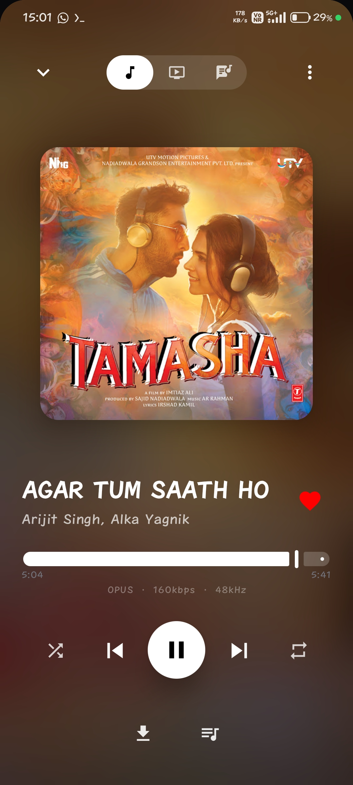
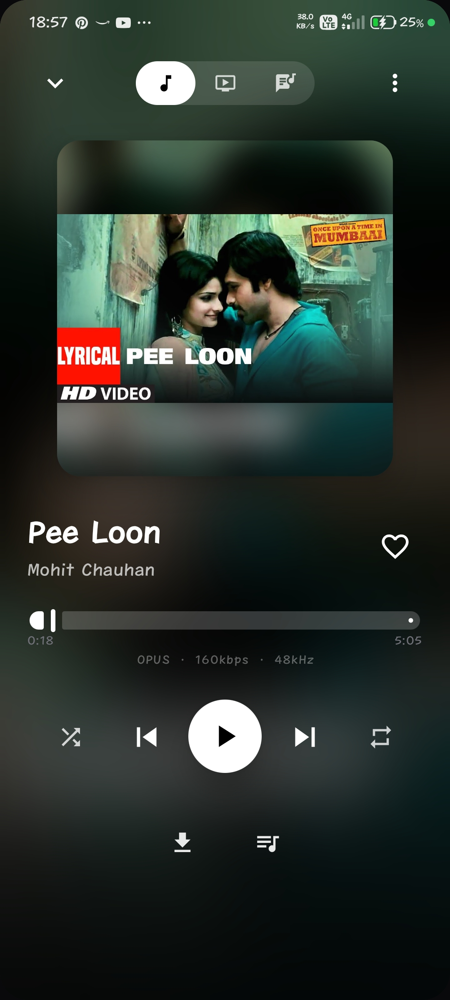

<p align="center">
  
</p>

<h1 align="center">Raazi Music Player</h1>

<p align="center">
  <strong>A modern, privacy-focused open-source Android music player built with Jetpack Compose & Kotlin.</strong>
</p>

<p align="center">
  
  
  
  
</p>

<p align="center">
  <a href="#features">Features</a> •
  <a href="#screenshots">Screenshots</a> •
  <a href="#tech-stack">Tech Stack</a> •
  <a href="#installation">Installation</a> •
  <a href="#permissions--privacy">Permissions</a> •
  <a href="#license">License</a>
</p>

---

## 🌟 Overview

**Raazi** is a high-performance Android music player designed from the ground up for privacy, speed, and aesthetics. It provides ad-free background playback directly from YouTube Music with advanced audio features, synchronized multi-source lyrics, on-device AI song recognition, and offline music management — with zero user tracking and no account required.

---

## ✨ Features

### 🎧 Pure Audio Experience
- **Ad-Free Background Playback**: Continuous audio playback with screen off or while multitasking.
- **Lossless FLAC Streaming**: High-fidelity multi-mirror lossless audio fallback.
- **Equalizer & Audio Effects**: Built-in 5-band equalizer, bass boost presets, and flat audio curve reset.
- **Lock-Screen & Notification Controls**: Android MediaSession integration with dynamic palette artwork colors.

### 🎤 Synchronized Lyrics & Romanization
- **Multi-Source Aggregator**: Automatic lyrics matching from Musixmatch, Genius, LrcLib, and NewPipe caption fallbacks.
- **Karaoke Word Glow**: Real-time synchronized word highlighting alongside classic line scrolling.
- **Smart Script Romanization**: Transliterate Hindi/Urdu lyrics to **Hinglish** and Bengali to Roman script on the fly.
- **Neural Translation**: In-app lyrics translation powered by Google Neural machine translation.

### 🤖 AI Song Finder (BYOK Gemini)
- **Search by Lyrics**: Identify songs from partial, misheard, or remembered lyrics excerpts.
- **Photo Identification**: Snap or upload album artwork, vinyl covers, or concert setlists to find tracks instantly.
- **Listen & Hum Recognition**: Record short audio clips or hum a melody for instant identification with your free Google Gemini API key.
- **Web Verification**: Double-check AI song guesses with grounded Google Search results.

### 📥 Offline Downloads & Local Library
- **Dedicated Downloads Section**: 1-tap library access to your downloaded tracks, offline queues, and shuffle.
- **Local Audio Indexer**: Seamlessly integrates songs already stored on your device with streaming playlists.
- **Custom Playlist Wizard**: Search-driven step-by-step playlist creator.
- **Spotify Importer**: Import your favorite Spotify playlists into Raazi seamlessly.

### 🎙️ On-Device Voice Search
- **Instant Voice Search**: Custom speech overlay with live audio waveform animation.
- **Graceful Permissions**: Dedicated dialog guiding you to grant microphone access if previously denied.

### ☁️ Cloud Sync & Integrations
- **Google Drive Backup**: Sync liked songs, playlists, and history to your private Google Drive `appDataFolder`.
- **Last.fm Scrobbling**: Real-time background scrobbling for tracking listening habits.
- **Verified App Links**: Open songs, albums, and playlists directly via `raazi.pages.dev` and `raazi://` links.

### 🎨 Material 3 & Customization
- **Dynamic Theming**: Dynamic wallpaper-derived colors (Material You) with Emerald, Lavender, Sky, and Peach accents.
- **AMOLED Pure Black**: Battery-saving deep black theme for OLED screens.
- **Floating Micro-Player**: Swipe down player into a draggable mini bubble.
- **Biometric App Lock**: Secure your library and playback with fingerprint or facial authentication.

---

## 📱 Screenshots

<p align="center">
  
  &nbsp;&nbsp;
  
</p>

---

## 🛠️ Tech Stack

Raazi is architected with modern Android development standards:

| Component | Library / Framework |
|---|---|
| **Language** | Kotlin 2.0.21 |
| **UI Framework** | Jetpack Compose (BOM 2025.02.00) with Material 3 |
| **Architecture** | Single-Activity MVVM, Manual Dependency Injection |
| **Concurrency** | Kotlin Coroutines & Asynchronous Flow |
| **Audio Playback** | AndroidX Media3 (ExoPlayer 1.6.0) with OkHttp DataSource |
| **Streaming Engine** | NewPipe Extractor v0.26.5 & Vendored InnerTube |
| **Local Persistence** | Room 2.6.1 Database (with safe migrations) & DataStore Preferences |
| **Networking** | OkHttp 4.12, Retrofit 2.9, Ktor Client 3.3 |
| **Image Loading** | Coil Compose 2.7.0 |
| **Security & Hardening** | R8 Full Mode minification, resource shrinking, ProGuard rules |

---

## 🔐 Permissions & Privacy

Raazi is strictly privacy-first: **no telemetry, no accounts required, and zero user data collection**.

| Permission | Purpose |
|---|---|
| `POST_NOTIFICATIONS` | Required on Android 13+ to show playback controls in the status bar and lock screen. |
| `RECORD_AUDIO` | Used solely when triggering Voice Search or the AI song hum identifier. |
| `READ_MEDIA_AUDIO` | Enables loading audio files stored locally on your device into your library. |
| `BLUETOOTH_CONNECT` | Displays connected headphone status and battery indicators. |
| `FOREGROUND_SERVICE` | Keeps audio streaming reliably when the screen is turned off. |

---

## 🚀 Installation

Download the latest signed release APK from the **[GitHub Releases](https://github.com/israrxy/Raazi/releases)** page:

1. Download `Raazi-v6.8.0.apk`.
2. Open the downloaded file on your Android device (Android 7.0 / API 24 or higher).
3. If prompted, permit installation from your browser or file manager.
4. Enjoy completely ad-free music!

---

## 💻 Building from Source

To build Raazi locally:

```bash
# 1. Clone the repository
git clone https://github.com/israrxy/Raazi.git
cd Raazi

# 2. Build debug APK using the Gradle wrapper
./gradlew :app:assembleDebug

# 3. Output APK location:
# app/build/outputs/apk/debug/app-debug.apk
```

---

## 📄 License

Raazi is licensed under the **[GNU General Public License v3.0](LICENSE)**.

```
Raazi Music Player
Copyright (C) 2026 Md Israr Ahamed

This program is free software: you can redistribute it and/or modify
it under the terms of the GNU General Public License as published by
the Free Software Foundation, either version 3 of the License, or
(at your option) any later version.
```

---

## 🙏 Acknowledgements

- **[TeamNewPipe](https://github.com/TeamNewPipe/NewPipeExtractor)** for the YouTube extraction engine.
- **[OuterTune](https://github.com/dd injustices/OuterTune)** & **[InnerTube](https://github.com/zionhuang/InnerTube)** for API inspiration.
- The **Android Open Source Community** for modern Jetpack libraries.
